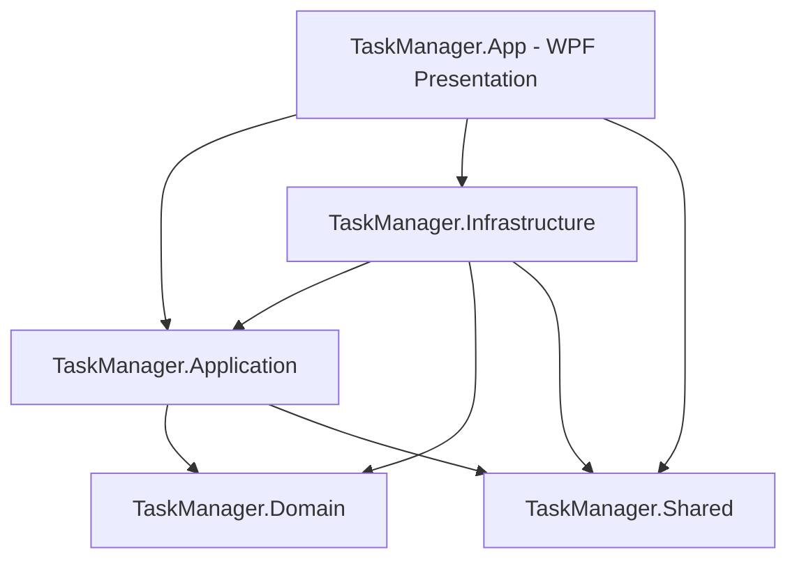
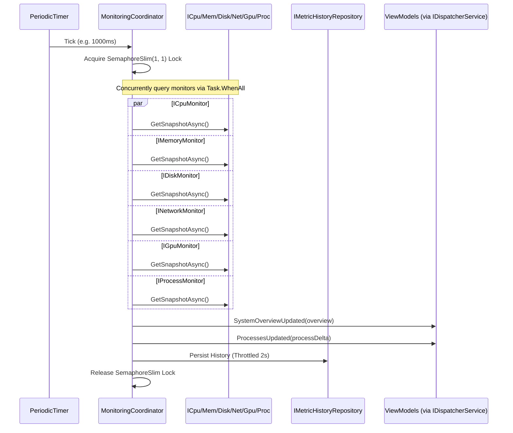

# Architecture Documentation

## 1. Architectural Overview

The Modern Windows Task Manager is architected according to **Clean Architecture** principles and the **Model-View-ViewModel (MVVM)** presentation pattern. It leverages .NET 10 LTS and Microsoft Generic Host (`IHost`) to provide dependency injection, lifecycle management, and clean layer boundaries.

### Layer Responsibilities

1. **TaskManager.Domain** (`net10.0`):
   - Contains enterprise business models (`ProcessModel`, `SystemMetrics`, `ServiceItem`, `StartupAppItem`, `UserSessionItem`).
   - Contains persistent entities (`UserSettingEntity`, `MetricHistoryRecord`, `ProcessFilterEntity`).
   - Completely independent with zero dependencies on other layers or UI frameworks.

2. **TaskManager.Shared** (`net10.0`):
   - Contains cross-cutting contracts, enums (`AppTheme`, `NavigationPage`), and functional primitives (`Result<T>`).
   - Zero dependencies on other solution projects.

3. **TaskManager.Application** (`net10.0`):
   - Defines monitoring contracts (`ICpuMonitor`, `IMemoryMonitor`, `IDiskMonitor`, `INetworkMonitor`, `IGpuMonitor`, `IProcessMonitor`, `IServiceMonitor`, `IStartupApplicationMonitor`, `IUserSessionMonitor`).
   - Defines repository interfaces (`ISettingsRepository`, `IMetricHistoryRepository`, `IProcessFilterRepository`).
   - Defines infrastructure abstractions (`IDispatcherService`, `ISettingsService`, `IDiagnosticLogService`, `IThemeService`, `INavigationService`).
   - Houses all ViewModels (`ShellViewModel`, `DashboardViewModel`, `ProcessesViewModel`, `PerformanceViewModel`, `ServicesViewModel`, `StartupAppsViewModel`, `UsersViewModel`, `SettingsViewModel`).

4. **TaskManager.Infrastructure** (`net10.0-windows`):
   - Concrete Windows telemetry providers querying Win32 APIs, WMI (`System.Management`), Performance Counters, and Service Controllers.
   - EF Core SQLite `TaskManagerDbContext` and repository implementations (`SettingsRepository`, `MetricHistoryRepository`, `ProcessFilterRepository`).
   - Central background coordinator `MonitoringCoordinator` implementing `IHostedService`.
   - Logging diagnostics service `DiagnosticLogService` reading Serilog logs.

5. **TaskManager.App** (`net10.0-windows`, `UseWPF=true`):
   - Host bootstrapper in `App.xaml.cs`.
   - Windows 11 Fluent Theme dictionaries (`DarkTheme.xaml`, `LightTheme.xaml`, `Styles.xaml`).
   - Custom Controls (`MetricCard`, `PerformanceChart`, `SearchBox`, `StatusIndicator`).
   - Reusable modal dialogs (`ConfirmationDialog`).
   - Value Converters (`BytesToSizeConverter`, `PercentageToColorConverter`, `TimeSpanToUptimeConverter`, `ProcessStatusConverter`, `BooleanToVisibilityConverter`, `LogLevelToColorConverter`).
   - Navigation and dispatching services (`WpfDispatcherService`, `NavigationService`, `ThemeService`).

---

## 2. Monitoring Engine Architecture

The core of the telemetry pipeline is the `MonitoringCoordinator`:

### Fault Isolation & Concurrency Guarding
- **Cycle Overlap Guard**: `_cycleLock.WaitAsync(0)` prevents pipeline stacking if hardware sampling takes longer than the configured tick interval.
- **Provider Isolation**: Each monitor call is wrapped in `SafeQueryAsync`. A failure in one provider (e.g. GPU driver crash or WMI query timeout) returns a safe fallback and does not crash the coordinator or halt other monitors.
- **Dynamic Reconfiguration**: In .NET 10, `PeriodicTimer.Period` is updated dynamically when `Interval` property changes, eliminating thread pool churn or restart delays.

---

## 3. UI Marshaling & In-Place Differential Updates

### The Differential Process Update Engine
Standard WPF DataGrid refreshes that clear and re-populate the collection cause visible flickering, reset user scroll offset, and drop selected rows. 

To solve this, `ProcessesViewModel` utilizes an in-place differential engine:
1. Every process is indexed by a compound key:
   $$\text{ProcessKey} = \text{PID} + \text{"\_"} + \text{StartTimeTicks}$$
2. The compound key prevents PID reuse conflicts.
3. On every tick, existing entries in `_processMap` update their reactive properties (`CpuPercent`, `MemoryWorkingSetBytes`, `DiskThroughputBytesPerSec`, `Status`) in place.
4. New processes are appended; terminated processes are removed.
5. User selection, sort column, and scroll position remain completely uninterrupted.

### Thread-Safe Dispatching
Background events from `MonitoringCoordinator` arrive on worker thread pool threads. The `IDispatcherService` abstraction isolates the UI synchronization:
- In production (`WpfDispatcherService`): Uses `System.Windows.Application.Current.Dispatcher.Invoke()`.
- In unit testing (`ImmediateDispatcherService`): Executes synchronously on the test runner thread without needing a WPF Dispatcher frame.

---

## 4. Persistence Architecture

Persistence is built on **Entity Framework Core 10** with **SQLite**:

- **Database Location**: `%APPDATA%/TaskManager/taskmanager.db` (auto-creates directories and runs `Database.EnsureCreated()` on app startup).
- **Entities**:
  - `UserSettingEntity`: Key-value configuration pairs with `UpdatedAtUtc`.
  - `MetricHistoryRecord`: Bounded historical samples (Timestamp, CPU %, RAM %, Disk Active %, Network Throughput) with indexed `Timestamp`.
  - `ProcessFilterEntity`: Process favorites and watch-list entries.
- **Automated Retention Pruning**: The background coordinator prunes records older than `UserSettings.HistoryRetentionHours` every 5 minutes using `IMetricHistoryRepository.PruneRecordsOlderThanAsync`.
- **Captive Dependency Prevention**: `SettingsService` and `MonitoringCoordinator` resolve scoped DbContext instances via `IServiceScopeFactory`, ensuring thread safety and preventing DbContext instance collisions.

---

## 5. Security & Permission Boundaries

- **Least Privilege Operation**: The application functions without elevation for normal monitoring and process viewing.
- **UAC Elevation & Protected Processes**: Windows denies access to protected system processes (e.g. `csrss.exe`, `lsass.exe`). The monitor catches `Win32Exception` and `UnauthorizedAccessException` gracefully, displaying placeholder descriptions and disabling termination actions rather than crashing.
- **Destructive Operations Guard**: A user confirmation dialog (`ConfirmationDialog`) protects against accidental process or process tree termination, with an override toggle in Settings.
- **Global Error Interception**: `App.xaml.cs` binds `DispatcherUnhandledException`, `AppDomain.CurrentDomain.UnhandledException`, and `TaskScheduler.UnobservedTaskException` to Serilog, preventing silent process termination.
